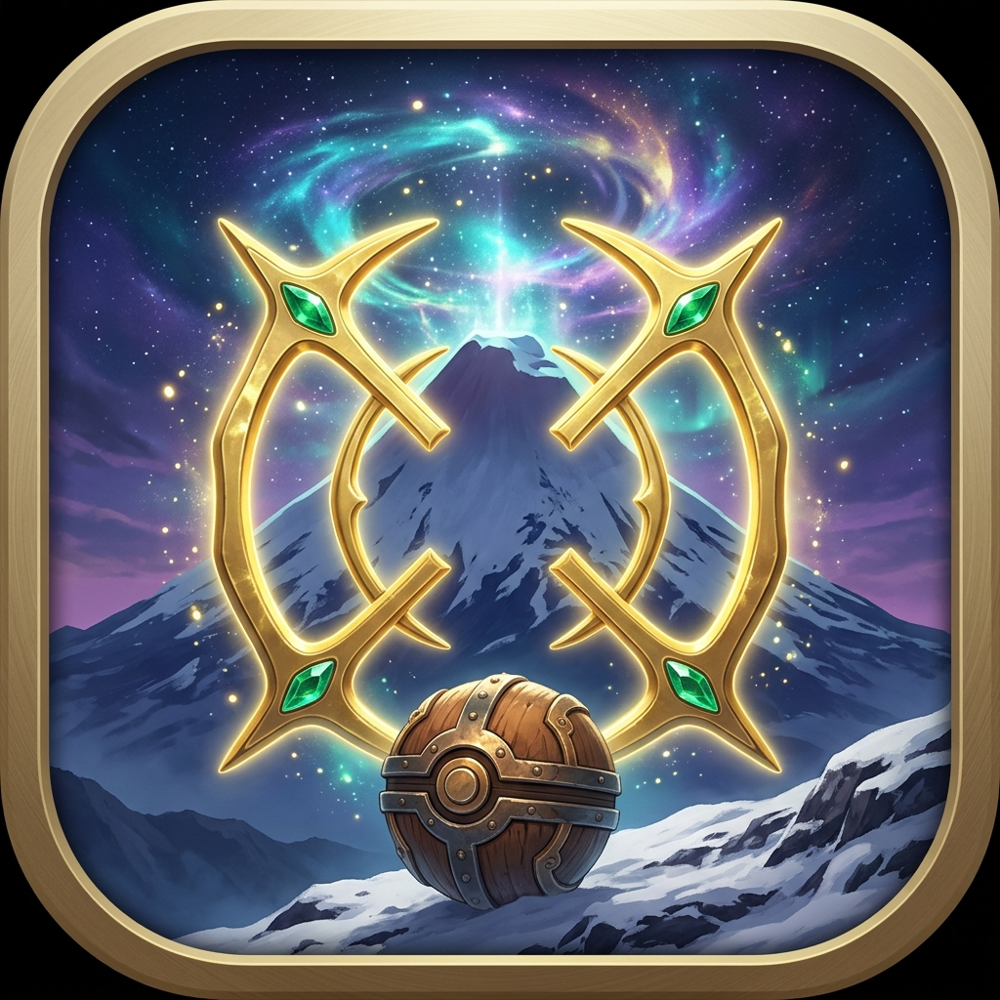

# PokeV-Recomp (SV Recomp)

**Port nativo para PC de *Pokémon Scarlet & Violet*, feito por recompilação estática.**

[English](README.md) · **Português (Brasil)**

[Relatar um problema](https://github.com/fabioschmidt01/PokeV-Recomp-privado/issues) ·
[Lançamentos (Releases)](https://github.com/fabioschmidt01/PokeV-Recomp-privado/releases)

---

O **PokeV-Recomp** (SV Recomp) transforma o código do Nintendo Switch de *Pokémon Violet & Scarlet* em um executável nativo de 64 bits para Windows e Linux.
O código de máquina ARM64 do jogo é traduzido antecipadamente (AOT) para C e compilado de forma nativa para x86-64. O microkernel do Horizon OS, sistema de arquivos, áudio e gráficos NVN da GPU Maxwell são recriados diretamente sobre o **Vulkan**.

**Nenhum emulador roda enquanto você joga.** O jogo roda diretamente no seu processador e placa de vídeo.

> [!IMPORTANT]
> **Você precisa da sua própria cópia do jogo.** O PokeV-Recomp não inclui código do jogo, ROMs, texturas, modelos nem chaves de criptografia. Você deve extrair o jogo legalmente adquirido (`.nsp` / `.xci` + atualização 3.0.1) e as `prod.keys` do seu próprio Nintendo Switch.

---

## Recursos

### Desempenho e Engine
- **60 FPS Nativo** na velocidade original do jogo ou paridade de 30 FPS do console.
- **Escala de Resolução Interna**: De 25% até 4x a resolução 1080p (4K UHD) com escalonamento dinâmico.
- **Escalonamento para CPUs Multi-Core (Intel Xeon e Ryzen)**: Descompactador de texturas assíncrono dinâmico (até 10 threads de trabalho em processadores com 16 a 24+ threads), eliminando engasgos ao carregar o mundo aberto de Paldea.
- **Pool de Memória GPU Desbloqueado (Intel Arc e GPUs de Alta VRAM)**: Desbloqueio do pool de memória para GPUs dedicadas (como os 12 GB da Intel Arc B580 Xe2 Battlemage), prevenindo gargalos de alocação.

### Gráficos e Upscaling
- **Intel XeSS (Xe Super Sampling)**: Upscaling neural por IA acelerado por hardware nos núcleos matriciais XMX das placas Intel Arc (com fallback DP4a para outras GPUs).
- **AMD FidelityFX FSR 1, FSR 2 (temporal)** e suavização **SMAA**.
- **Iluminação e Sombras Customizadas**: Oclusão de ambiente em espaço de tela (XeGTAO), reflexos de água e iluminação global.
- **Saída em HDR**: Suporte a scRGB e HDR10.
- **Carregador de Pacotes de Texturas HD**: Carregamento direto de `textures/hd/`.

### Controles e Entrada
- Qualquer controle moderno via SDL3: Xbox, DualShock 4, DualSense, Nintendo Switch Pro Controller e Steam Deck.
- Suporte completo a Teclado e Mouse com câmera livre no mouse e mapeamento configurável.
- Glifos de botões dinâmicos de acordo com o controle conectado.

---

## Versão Suportada

| Jogo | Title ID | Versão Alvo | Build ID (`main`) |
|---|---|---|---|
| **Pokémon Violet** | `01008F6008C5E000` | **3.0.1** (update v786432) | `709BFD6611529864` |
| **Pokémon Scarlet** | `0100A3D008C5C000` | **3.0.1** (update v786432) | (Compatível) |

---

## Requisitos

| Componente | Mínimo | Recomendado |
|---|---|---|
| **Sistema Operacional** | Windows 10/11 64-bit ou Linux x86-64 (glibc 2.35+) | Windows 11 / Linux Moderno |
| **Processador** | x86-64 com AVX2 (4 Cores) | Intel Xeon E5 / Core i5/i7/i9 ou AMD Ryzen (8+ Cores) |
| **Placa de Vídeo** | Compatível com Vulkan 1.3 (4 GB VRAM) | **Intel Arc B580 (12 GB)** / RTX 3060+ / RX 6600+ |
| **Memória RAM** | 8 GB RAM | 16 GB+ RAM |
| **Armazenamento** | ~15 GB de espaço livre | SSD / NVMe |

---

## Como Jogar

1. Baixe o release mais recente na aba de [Releases](https://github.com/fabioschmidt01/PokeV-Recomp-privado/releases) (`PokeV-Recomp-windows-x64.zip`).
2. Extraia o arquivo para uma pasta acessível (ex: `C:\Jogos\PokeV-Recomp`).
3. Prepare os arquivos do jogo:
   - Jogo base (`.nsp` ou `.xci`), a **atualização 3.0.1** (`.nsp`), e o arquivo `prod.keys` extraído do seu Switch.
4. Abra o executável `lasrecomp.exe`.
5. Na tela inicial, selecione a pasta com os arquivos do jogo e clique em **Configurar o jogo**.
6. A recompilação inicial levará de 10 a 25 minutos dependendo da CPU (ocorre **apenas uma vez**).
7. Clique em **Jogar** e aproveite Paldea!

---

## Controles Básicos

| Teclado | Ação | Controle |
|---|---|---|
| W / A / S / D | Mover personagem | Analógico Esquerdo |
| Movimento do Mouse | Mover a câmera | Analógico Direito |
| Clique Esquerdo / Espaço | Interagir / Pular | A / B |
| Clique Direito | Mirar / Travar Mira | ZL |
| F1 / Esc | Menu de Configurações | + / − |
| F10 | Salvar Captura de Tela (`screenshots/`) | - |
| F11 | Alternar Tela Cheia | - |

---

## Créditos e Agradecimentos

- **Peiikai**: Criador do [LAS Recomp](https://github.com/peiikai/LASRecomp), arquitetura de runtime e tradutor de shaders Maxwell.
- **Hexveil404**: Criador do [PokeZ-ARecomp](https://github.com/Hexveil404/PokeZ-ARecomp), introduzindo serviços HLE do Switch e otimizações para a engine de Pokémon.
- **fabioschmidt01 & Antigravity**: Arquitetura, multi-threading para Intel Xeon, otimizações Intel Arc B580, integração Intel XeSS e ports para Pokémon Violet e Arceus.
- **Projeto Ryujinx**: Referência de comportamento para kernel do Switch e GPU NVN.
- **Bibliotecas open-source**: SDL3, FFmpeg, Dear ImGui, Vulkan Memory Allocator, Shaderc, XeGTAO, LibHac, Intel XeSS SDK.
